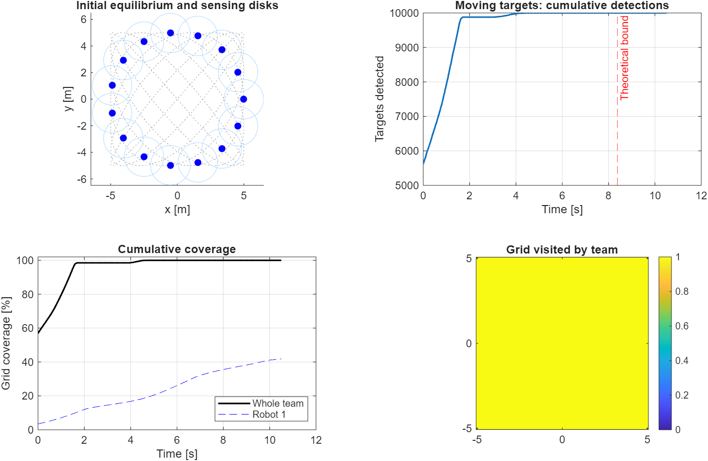
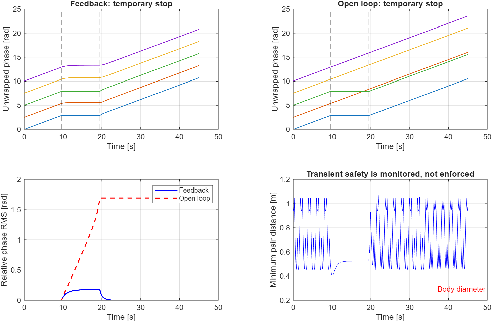
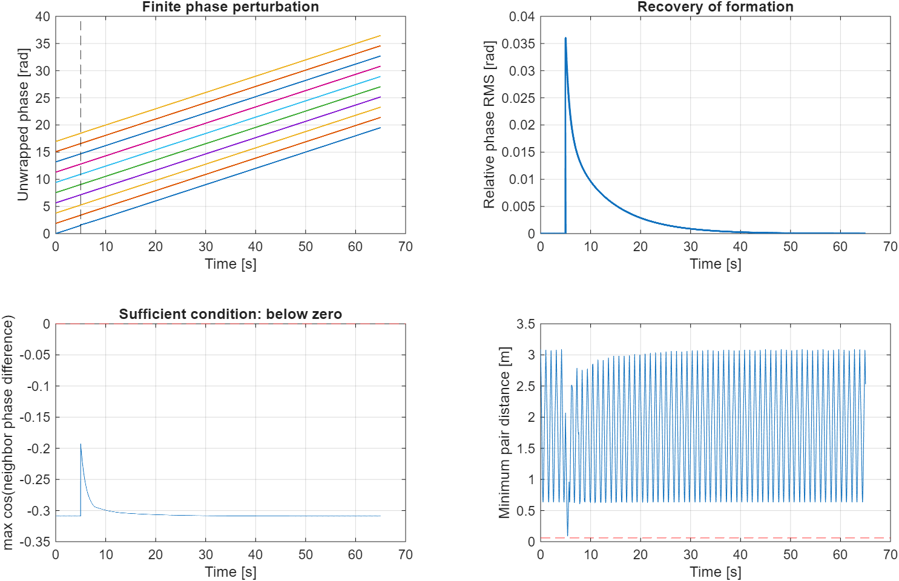

# BÁO CÁO TIẾN ĐỘ BÀI TẬP LỚN

**Tên đề tài đề xuất:** Mô phỏng điều khiển phối hợp đa robot phục vụ giám sát liên tục và phát hiện mục tiêu bằng mô hình Kuramoto đảo thời gian kết hợp đường cong Lissajous.

**Thời điểm cập nhật:** 28/10/2026.

**Tài liệu nghiên cứu chính:** M. Boldrer, L. Lyons, L. Palopoli, D. Fontanelli và L. Ferranti, “Time-Inverted Kuramoto Model Meets Lissajous Curves: Multi-Robot Persistent Monitoring and Target Detection,” *IEEE Robotics and Automation Letters*, vol. 8, no. 1, pp. 240–247, 2023. DOI: 10.1109/LRA.2022.3224661.

## 1. Tiến độ đã đạt được

### 1.1. Nghiên cứu bài toán và cơ sở lý thuyết

Đã đọc và tổng hợp nội dung bài báo, xác định bài toán điều khiển một nhóm robot di chuyển trên quỹ đạo tuần hoàn trong khu vực hình chữ nhật không có vật cản. Các mục tiêu gồm giám sát liên tục, phát hiện mục tiêu trong thời gian hữu hạn, duy trì cấu hình phối hợp và xem xét khả năng tránh va chạm.

Đã tìm hiểu các thành phần chính của phương pháp:

- Đường cong Lissajous để tạo quỹ đạo kín, trơn và quét khu vực.
- Mô hình Kuramoto đảo thời gian để điều chỉnh quan hệ pha giữa các robot.
- Mạng truyền thông vòng vô hướng, trong đó mỗi robot trao đổi thông tin với hai hàng xóm.
- Cấu hình cân bằng tương đối, điều kiện ổn định và tham số nhóm đồng pha kappa.
- Các điều kiện đủ về phạm vi cảm biến, kích thước robot và thời gian phát hiện mục tiêu.
- Nguyên lý MPCC để chuyển tốc độ pha mong muốn thành điều khiển robot có động lực học và giới hạn đầu vào.

Đã phân biệt yêu cầu phủ khu vực với yêu cầu phát hiện mục tiêu di động; đồng thời xác định rằng khả năng phục hồi đội hình không tự động bảo đảm tránh va chạm trong toàn bộ quá trình quá độ.

### 1.2. Xây dựng chương trình MATLAB

Đã xây dựng mã mô phỏng theo cấu trúc mô-đun, gồm cấu hình tham số, tạo mạng truyền thông, tích phân động lực học pha, ánh xạ pha sang tọa độ, mô phỏng mục tiêu, đánh giá độ phủ và biểu diễn kết quả.

Mô hình pha được tích phân bằng phương pháp Runge–Kutta bậc 4. Các thời điểm bắt đầu/kết thúc sự cố và thời điểm tác động nhiễu được chèn vào lưới thời gian để thực hiện sự kiện đúng mốc.

Các kịch bản đã triển khai:

1. Phát hiện 10.000 mục tiêu di động bằng đội hình 15 robot.
2. Hai robot dừng tạm thời; so sánh phối hợp có phản hồi với điều khiển vòng hở.
3. Một robot chịu nhiễu pha; đánh giá khả năng phục hồi cấu hình.
4. Ví dụ MPCC cho ba xe mô phỏng có động lực học và hai tác tử ảo.

Đã bổ sung chức năng xuất hình PNG/FIG, lưu dữ liệu MAT, hoạt hình chuyển động và chương trình kiểm tra số học. Các tham số tự lựa chọn do bài báo không công bố đầy đủ được ghi trong mã và tài liệu hướng dẫn.

### 1.3. Kết quả kiểm tra ban đầu

Chương trình đã được thực thi trên MATLAB R2025a. Kết quả kiểm tra mô hình lý tưởng được tổng hợp như sau:

| Nội dung | Kết quả hiện tại | Phạm vi diễn giải |
|---|---|---|
| Phát hiện mục tiêu | Phát hiện 10.000/10.000 mục tiêu trong lần chạy đã kiểm tra | Mục tiêu ngẫu nhiên, seed 42, phản xạ tại biên, cảm biến lý tưởng |
| Giới hạn thời gian phát hiện | T_max = 8,3776 s; kiểm tra thời gian phát hiện đạt yêu cầu với dung sai một bước lấy mẫu | Dùng công thức lý thuyết và kiểm tra số rời rạc |
| Độ phủ của toàn đội | 100% các điểm trên lưới 101 × 81 | Không đồng nghĩa với chứng minh phủ liên tục bằng thực nghiệm |
| Dừng tạm thời | Đội hình có phản hồi phục hồi quan hệ pha sau khi robot hoạt động lại | Kịch bản hai robot dừng từ 9,6 đến 19,5 s |
| Sai số pha cuối với phản hồi | Khoảng 6,95 × 10^-14 rad | Sai số RMS sau khi loại bỏ thành phần quay chung |
| Sai số pha cuối với vòng hở | Khoảng 1,6941 rad | Cùng kịch bản dừng tạm thời |
| Nhiễu pha | Phục hồi về cấu hình ban đầu trong ngưỡng kiểm tra | Theo dõi đến 65 s, nhiễu 0,12 rad tại t = 5 s |
| MPCC | Đã chạy thử 0,2 s mô phỏng, 6 lần gọi bộ giải đều có exitflag dương | Mới kiểm tra khởi chạy, chưa đánh giá đầy đủ kịch bản dài |

Các kiểm tra về phương trình tại cân bằng quay, tác động sự cố đúng thời điểm, khả năng phục hồi và độ nhất quán khi giảm bước tích phân đều đạt trong các trường hợp đã chạy.

### 1.4. Sản phẩm đã có và phần chưa hoàn thành

Các sản phẩm hiện có:

- `run_paper_simulation.m`: chương trình mô phỏng chính.
- `+tikm/`: các hàm mô hình, mô phỏng và đánh giá.
- `animate_paper_simulation.m`: biểu diễn chuyển động.
- `run_mpcc_demo.m`: ví dụ mô phỏng xe với MPCC.
- `test_paper_simulation.m`: kiểm tra số học.
- `results/`: hình và dữ liệu kết quả.
- `matlab_validation.log`: nhật ký thực thi.
- `README_MATLAB.md`: hướng dẫn sử dụng và phạm vi tái lập.

Chưa hoàn thành khảo sát độ nhạy theo nhiều tham số, đánh giá thống kê qua nhiều seed, đánh giá MPCC trong khoảng thời gian dài và đối chiếu định lượng đầy đủ với các hình trong bài báo. Chưa triển khai UAV 3D hoặc thí nghiệm robot thật. Các hình hiện có là kết quả mô phỏng của chương trình, không phải dữ liệu thực nghiệm gốc của tác giả.

## 2. Kế hoạch tiếp theo

Kế hoạch dưới đây được đề xuất cho bốn tuần sau thời điểm báo cáo; có thể điều chỉnh theo hạn nộp chính thức của học phần.

| Thời gian dự kiến | Nhiệm vụ | Sản phẩm và tiêu chí hoàn thành |
|---|---|---|
| 29/10–04/11/2026 | Rà soát ánh xạ pha–tọa độ, điều kiện cân bằng và công thức giới hạn; chạy lại các kịch bản ở nhiều bước tích phân và mật độ lưới | Bảng tham số thống nhất, kết quả kiểm tra hội tụ số và chú thích rõ tham số lấy từ bài báo/tự chọn |
| 05/11–11/11/2026 | Khảo sát N, omega, bán kính cảm biến, cường độ nhiễu và thời gian robot dừng; chạy phát hiện mục tiêu với nhiều seed | Đồ thị độ nhạy, bảng tỷ lệ phát hiện, thời gian phục hồi và khoảng cách nhỏ nhất; chỉ so sánh các cấu hình thỏa giả thiết phù hợp |
| 12/11–18/11/2026 | Chạy và đánh giá MPCC trong kịch bản 8–30 s; kiểm tra sai số bám đường, giới hạn đầu vào, trạng thái bộ giải và nguy cơ va chạm | Báo cáo kết quả MPCC, thống kê exitflag, sai số và thời gian tính toán; xác định nguyên nhân khi không đạt |
| 19/11–25/11/2026 | Đối chiếu với nội dung bài báo; hoàn thiện báo cáo, hình minh họa và slide | Bản báo cáo hoàn chỉnh, bộ mã có hướng dẫn chạy và nội dung trình bày |

Nếu thời gian cho phép, hướng mở rộng là nghiên cứu ràng buộc tránh va chạm trong bộ điều khiển tầng thấp hoặc xây dựng mô hình UAV. Đây là nội dung mở rộng, chưa tính là kết quả đã hoàn thành và cần đánh giá lại tác động đến bảo đảm giám sát/phát hiện.

## 3. Bản thảo nội dung bài tập lớn

### 3.1. Đặt vấn đề và mục tiêu nghiên cứu

Giám sát liên tục và phát hiện mục tiêu là các nhiệm vụ quan trọng trong ứng dụng đa robot như tuần tra khu vực, kiểm tra cơ sở hạ tầng và theo dõi môi trường. Khi số lượng robot và phạm vi cảm biến không đủ để quan sát đồng thời toàn bộ không gian, cần tổ chức chuyển động để khu vực được quét lặp lại.

Việc sử dụng nhiều robot có thể tăng khả năng làm việc song song và tạo dự phòng. Tuy nhiên, sai số chuyển động hoặc việc một robot dừng tạm thời có thể phá vỡ cấu hình phối hợp và làm giảm hiệu quả giám sát. Vì vậy, cần cơ chế phản hồi cho phép đội hình tự điều chỉnh.

Bài tập lớn tập trung nghiên cứu và mô phỏng phương pháp kết hợp Kuramoto đảo thời gian với quỹ đạo Lissajous. Mục tiêu là hiện thực phương trình trên MATLAB, đánh giá khả năng phủ khu vực, phát hiện mục tiêu và phục hồi đội hình; đồng thời bước đầu xem xét ảnh hưởng của động lực học robot thông qua MPCC.

### 3.2. Mô hình bài toán và giả thiết

Xét khu vực hình chữ nhật:

\[
\mathcal D=[-A,A]\times[-B,B].
\]

Đội hình gồm N robot có cảm biến đa hướng bán kính r_s và bán kính chiếm chỗ r. Môi trường đã biết và không có vật cản. Trong mô hình lý tưởng, các robot chuyển động chính xác trên đường tham chiếu và trao đổi pha qua mạng vòng vô hướng cố định.

Mỗi robot có một biến pha theta_i xác định tiến độ trên đường. Biến pha khác với góc hướng thân robot. Cấu hình cân bằng được hiểu là chênh lệch pha giữa các robot không đổi, trong khi toàn đội vẫn có thể chuyển động.

### 3.3. Xây dựng quỹ đạo Lissajous

Quỹ đạo có dạng:

\[
x(\gamma)=A\cos(a\gamma),\qquad
y(\gamma)=B\sin(b\gamma).
\]

Các tham số A và B xác định kích thước không gian; a và b xác định cấu trúc quỹ đạo. Trong các cấu hình đang sử dụng, chọn a lẻ, a và b nguyên tố cùng nhau, đồng thời a+b=N. Đây là lựa chọn để áp dụng các tính chất hình học của đường Lissajous không suy biến trong bài báo.

Robot i có vị trí:

\[
\mathbf r_i=
\begin{bmatrix}
A\cos(a\theta_i)\\
B\sin(b\theta_i)
\end{bmatrix}.
\]

Tốc độ tuyến tính phụ thuộc cả tốc độ pha và đạo hàm đường cong; vì vậy tốc độ pha bằng nhau không nhất thiết tạo ra tốc độ tuyến tính bằng nhau tại mọi vị trí.

### 3.4. Luật phối hợp Kuramoto đảo thời gian

Luật phối hợp được viết:

\[
\dot\theta_i=\omega-
\sum_{j\in\mathcal R_i}\sin(\theta_j-\theta_i).
\]

Trong đó omega là tốc độ pha tại cân bằng, còn R_i là tập hai hàng xóm của robot i. Thành phần phản hồi điều chỉnh tốc độ pha theo trạng thái tương đối, giúp duy trì hoặc phục hồi đội hình.

Theo thứ tự của vòng truyền thông, cấu hình cân bằng tương đối có dạng:

\[
\theta_i^*=\theta_0+\frac{2\pi p(i-1)}{N}\pmod{2\pi}.
\]

Các cấu hình ổn định được sử dụng có p nguyên thỏa N/4 < p < 3N/4. Đặt kappa=gcd(N,p), khi đó có N/kappa pha phân biệt và kappa robot trong mỗi nhóm đồng pha. Các thử nghiệm chính chọn kappa=1.

### 3.5. Điều kiện phủ khu vực, phát hiện và an toàn

Các điều kiện đủ được sử dụng để thiết kế và đánh giá cấu hình gồm:

\[
r_i<\sin\left(\frac{\pi}{N}\right)
\frac{AB}{\sqrt{A^2a^2+B^2b^2}}
\]

cho tránh va chạm tại cấu hình cân bằng 1-clustered phù hợp;

\[
r_{s,i}>\max\left\{
B\sin\left(\frac{\pi}{2a}\right),
A\sin\left(\frac{\pi}{2b}\right)
\right\}
\]

cho khả năng phủ toàn bộ khu vực theo thời gian; và

\[
r_{s,i}\ge\sin\left(\frac{\pi}{N/\kappa}\right)
\sqrt{A^2+B^2}
\]

cho phát hiện mục tiêu theo cấu trúc quét được phân tích trong bài báo. Thời gian phát hiện tối đa là:

\[
T_{\max}=\frac{2\pi\kappa}{N\omega}.
\]

Các công thức này phải được diễn giải cùng giả thiết của bài báo. Đặc biệt, an toàn tại cân bằng không bảo đảm an toàn cho mọi cấu hình ban đầu hoặc mọi quá độ sau nhiễu.

### 3.6. Thiết kế mô phỏng và chỉ tiêu đánh giá

Mô phỏng được chia thành ba thí nghiệm lý tưởng và một ví dụ MPCC. Thí nghiệm phát hiện sử dụng 15 robot và 10.000 mục tiêu điểm chuyển động, phản xạ tại biên. Thí nghiệm sự cố sử dụng năm robot, trong đó hai robot dừng tạm thời. Thí nghiệm nhiễu tác động một độ lệch pha lên một robot để quan sát khả năng phục hồi.

Các chỉ tiêu đánh giá gồm:

- Tỷ lệ mục tiêu được phát hiện và thời gian phát hiện lần đầu.
- Tỷ lệ điểm lưới đã được cảm biến quét qua, cho toàn đội và từng robot.
- Sai số RMS của cấu hình pha sau khi loại bỏ thành phần quay chung.
- Khoảng cách nhỏ nhất giữa mọi cặp robot.
- Với MPCC: sai số bám đường, đầu vào điều khiển, trạng thái hội tụ bộ giải và thời gian tính toán.

Để đánh giá độ tin cậy, kế hoạch tiếp theo bổ sung kiểm tra nhiều seed, nhiều bước tích phân và nhiều mật độ lưới.

### 3.7. Bộ điều khiển MPCC và phạm vi hiện thực

Ví dụ MPCC sử dụng mô hình xe đạp động học với trạng thái vị trí, góc hướng, tốc độ và tiến độ dọc đường. Đầu vào là góc lái và ga. Hàm mục tiêu kết hợp sai số tốc độ pha, sai số tiếp tuyến/pháp tuyến và chi phí đầu vào; các giới hạn lái và ga được đưa vào bài toán tối ưu.

Mã hiện tại sử dụng nội suy số để chuyển đổi độ dài cung sang pha, thay cho xấp xỉ đa thức trong bài báo. Chưa bổ sung ràng buộc tránh va chạm vào MPCC. Đây là hiện thực tham khảo để khảo sát ảnh hưởng của động lực học và khả năng bám đường, chưa phải bản sao đầy đủ bộ điều khiển thực nghiệm của tác giả.

### 3.8. Kết quả sơ bộ và thảo luận

Kết quả hiện tại cho thấy mô hình lý tưởng phát hiện đủ 10.000 mục tiêu của lần chạy đã kiểm tra và đạt 100% độ phủ trên lưới khảo sát. Trong kịch bản dừng tạm thời, phản hồi Kuramoto giúp đội hình khôi phục quan hệ pha; điều khiển vòng hở giữ sai lệch sau khi các robot hoạt động trở lại. Thử nghiệm nhiễu pha cũng cho thấy sai số suy giảm và trở về ngưỡng kiểm tra.

Các kết quả này hỗ trợ tính đúng đắn của việc hiện thực mô hình trong phạm vi các trường hợp đã chạy. Tuy nhiên, cần khảo sát thêm để đánh giá ảnh hưởng của tham số và khả năng tổng quát. Kết quả phát hiện phụ thuộc mô hình mục tiêu, phép lấy mẫu và cảm biến lý tưởng; kết quả độ phủ là xấp xỉ trên lưới. Các sai số rất nhỏ của mô hình pha không thể dùng để suy ra độ chính xác tương ứng của robot thật.

### 3.9. Kết luận dự kiến

Bài tập lớn đã xây dựng nền tảng lý thuyết và chương trình MATLAB để nghiên cứu phối hợp đa robot bằng Kuramoto đảo thời gian kết hợp Lissajous. Các kết quả sơ bộ thể hiện khả năng quét khu vực, phát hiện mục tiêu và phục hồi cấu hình trong một số kịch bản nhiễu hoặc dừng tạm thời. Giai đoạn tiếp theo tập trung khảo sát định lượng, đánh giá đầy đủ MPCC và hoàn thiện đối chiếu với bài báo.

## Minh chứng kết quả

*Hình 1. Quỹ đạo, vùng cảm biến, phát hiện mục tiêu và độ phủ trên lưới của mô hình lý tưởng.*

*Hình 2. So sánh diễn biến pha và sai số cấu hình khi hai robot dừng tạm thời; theo dõi khoảng cách nhỏ nhất.*

*Hình 3. Diễn biến sau nhiễu pha, điều kiện ổn định cục bộ và khoảng cách robot.*

Các hình trên do chương trình MATLAB của bài tập lớn sinh ra. Dữ liệu số được lưu trong `results/simulation_results.mat`; nhật ký kiểm tra nằm trong `matlab_validation.log`.
