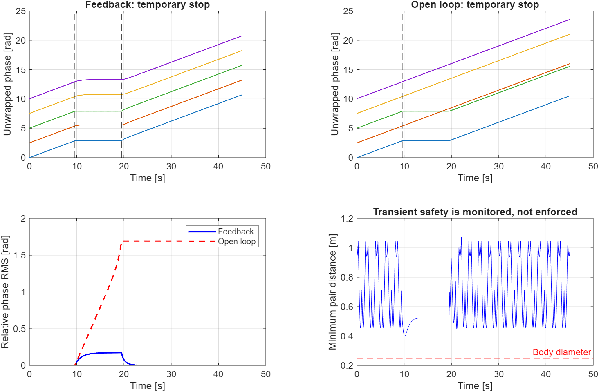

# Kuramoto–Lissajous Multi-Robot Simulation

Đã bổ sung triển khai **ROS 2 Humble + Gazebo Fortress** cho xe Ackermann 2WD,
Kuramoto–Lissajous và MPCC. Xem [hướng dẫn ROS 2](README_ROS2.md),
[kế hoạch triển khai](PLAN_ROS2_SWARM_PATROL.md) và [CAD tham chiếu STEP](cad/README.md).
Bản MATLAB nằm trong thư mục `matlab/`.

Mô phỏng trên MATLAB phương pháp phối hợp đa robot để giám sát liên tục và
phát hiện mục tiêu, dựa trên mô hình Kuramoto đảo thời gian kết hợp đường cong
Lissajous.

Tài liệu nghiên cứu: Boldrer et al., *Time-Inverted Kuramoto Model Meets
Lissajous Curves: Multi-Robot Persistent Monitoring and Target Detection*,
IEEE Robotics and Automation Letters, 8(1), 240–247, 2023.
[DOI: 10.1109/LRA.2022.3224661](https://doi.org/10.1109/LRA.2022.3224661).

## Chạy mô phỏng

Mở thư mục repository trong MATLAB và chạy:

```matlab
cd matlab
results = run_paper_simulation;
test_paper_simulation;
animate_paper_simulation(results.detection, 5);
```

Mô phỏng chính chỉ cần MATLAB cơ bản, khuyến nghị R2020b trở lên. Hình và
dữ liệu được xuất vào `results/`; các tệp MAT và FIG được tạo lại khi chạy.

Ví dụ MPCC cần Optimization Toolbox:

```matlab
car = run_mpcc_demo(struct('T', 8));
```

## Các kịch bản

- Phát hiện 10.000 mục tiêu di động bằng đội hình 15 robot.
- Hai robot dừng tạm thời; so sánh phản hồi Kuramoto với vòng hở.
- Nhiễu pha và khả năng phục hồi cấu hình.
- Ví dụ MPCC cho ba xe mô phỏng có động lực học và hai tác tử ảo.

## Kết quả và phạm vi kiểm tra

Đã chạy mô hình lý tưởng và các kiểm tra số học trên MATLAB R2025a: phát hiện
đủ 10.000 mục tiêu trong lần chạy kiểm tra, phủ 100% lưới khảo sát và phục hồi
cấu hình trong các kịch bản đã thử. MPCC mới được chạy thử 0,2 giây mô phỏng,
chưa xác nhận toàn bộ kịch bản dài.

Các tham số không được bài báo công bố đầy đủ được chọn và ghi rõ trong mã.
Đây là mô phỏng phương pháp, chưa tái tạo chính xác mọi hình trong bài báo,
chưa có thí nghiệm robot thật hay UAV 3D.



## Tài liệu dự án

- [Hướng dẫn chi tiết và các giả thiết](README_MATLAB.md).
- [Báo cáo tiến độ bài tập lớn](Bao_cao_tien_do_bai_tap_lon.md).
- Tham số mô phỏng: `matlab/+tikm/config.m`.
- Kiểm tra số học: `matlab/test_paper_simulation.m`.

PDF bài báo tham khảo không được đưa vào repository; truy cập qua DOI ở trên.
