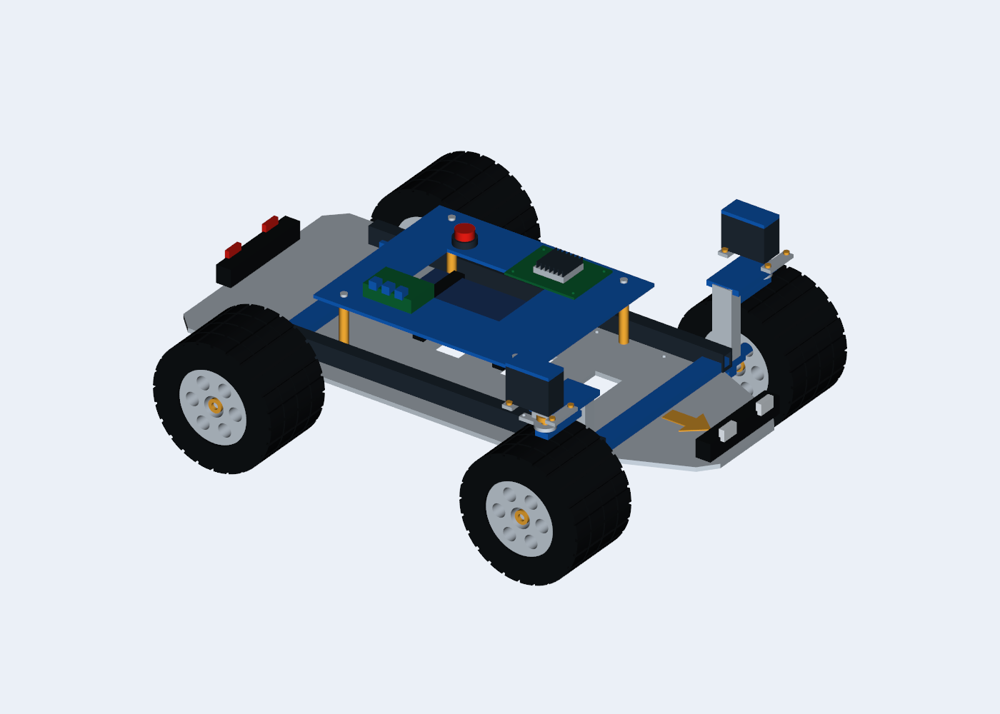

# CAD cơ khí xe Ackermann 2WD



`ackermann_mechanical.step` là bản chi tiết mới: **97 chi tiết lắp ghép**, đơn vị mm.
Mở bằng FreeCAD, SolidWorks hoặc Fusion. Tên từng chi tiết được giữ trong cây assembly.

Bản mới gồm:
- Sàn dưới 4 mm có lỗ M3 Ø3,4 mm và cửa giảm khối lượng, dầm khung, thanh ngang,
  sàn thiết bị phía trên, trụ đỡ, vít.
- Hai gearmotor cầu sau, hộp giảm tốc, gá động cơ, trục bánh.
- Hai servo lái trước, gá servo, ổ đỡ kingpin, upright/knuckle chữ C, horn và trục moay-ơ.
- Lốp có rãnh/gai, vành sáu cửa, hub, đai ốc; cản trước/sau, đèn và mũi tên hướng trước.
- Vỏ pin, đai giữ pin, bo điều khiển, tản nhiệt, driver và nút nguồn.

Đây là **cấu hình hai servo lái độc lập**: controller tính góc Ackermann cho mỗi bánh.
Không dùng servo trung tâm/thanh kéo liên kết hai bánh. Horn/knuckle quay theo joint
lái thật; vành/lốp quay theo joint lăn thật. Servo và động cơ là hình bao linh kiện phổ thông,
chưa phải mã linh kiện mua sẵn được xác nhận.

## Sửa và xuất lại

- `mechanical_vehicle.py`: nguồn CadQuery chỉnh sửa được, các chi tiết có tên riêng.
- `export_vehicle.py`: xuất STEP, 19 mesh nhóm theo link/vật liệu và include Xacro.
- `mechanical_manifest.json`: danh mục chi tiết, số lượng, thể tích, bounds, kích thước dùng chung.
- `src/ackermann_description/config/vehicle.json`: kích thước chính theo m/kg.
- `src/ackermann_description/meshes/mechanical/`: STL theo mm, URDF scale 0,001.

```bash
python3 -m venv /tmp/patrol-cad
/tmp/patrol-cad/bin/pip install -r cad/requirements.txt
/tmp/patrol-cad/bin/python cad/export_vehicle.py
bash scripts/build_ros2.sh --packages-select ackermann_description multi_robot_bringup
```

Không sửa trực tiếp `mechanical_visuals.xacro`: file này được exporter tạo lại.
Ảnh preview được render từ chính CAD bằng `cad/render_vehicle.py` (cần VTK và phiên OpenGL).
Gốc assembly ở tâm cầu sau chiếu xuống đất; X trước, Y trái, Z lên.
Wheelbase 285 mm, track 280 mm, đường kính bánh 110 mm, bánh rộng 70 mm.

## Xem trong mô phỏng

```bash
# Một xe ở gốc, RViz tự mở góc nhìn cận cảnh; không tự chạy tuần tra.
bash scripts/run_patrol.sh fleet:=single control:=false rviz:=true

# Ba xe vật lý và hai tác tử ảo tuần tra.
bash scripts/run_patrol.sh rviz:=true
```

Trong Gazebo, chọn model `robot_2` trong Entity Tree và dùng Move To để focus xe.
Nếu phiên cũ đang chạy, Ctrl+C rồi khởi động lại để nạp URDF mới.

## Phạm vi cơ khí và mô phỏng

Bản này bổ sung hình học thiết kế và hình hiển thị. Mô hình collision/inertia/khớp vật lý
được giữ theo bản đã kiểm chứng; lỗ lắp và từng gai lốp không tạo collision riêng.
Khối lượng chưa được tính lại từ vật liệu của từng chi tiết. Chưa có mô phỏng đàn hồi
hệ treo, bánh răng/servo bên trong hoặc tải trên ổ bi.

Đây là CAD để phát triển tiếp, **chưa phải bộ hồ sơ chế tạo**. Trước khi chế tạo cần chọn
linh kiện, hoàn thiện lắp ghép trục/ổ bi/servo, kiểm tra giao thoa toàn dải lái,
bổ sung dung sai, vật liệu và bản vẽ. Các hình bao linh kiện không thay thế bản vẽ hãng.

Nguồn tham khảo và revision đã kiểm tra: [REFERENCES.md](REFERENCES.md).
