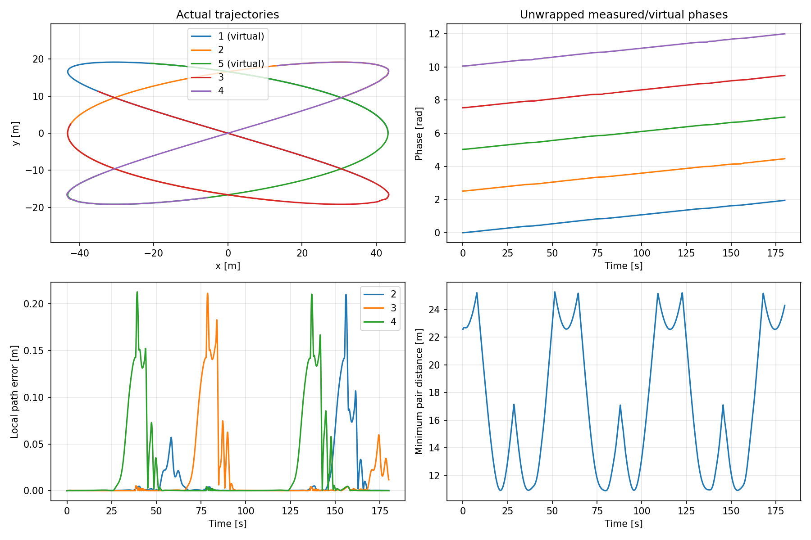
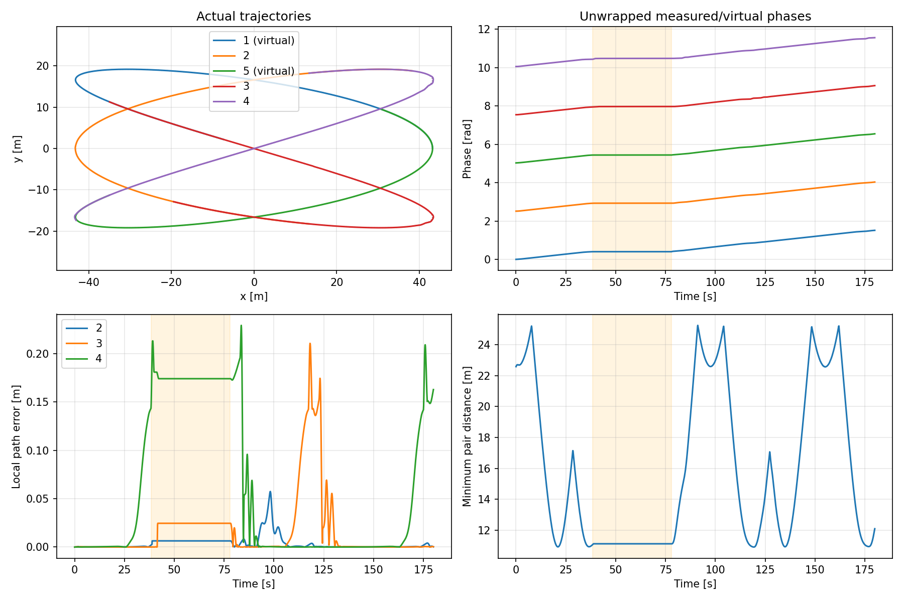
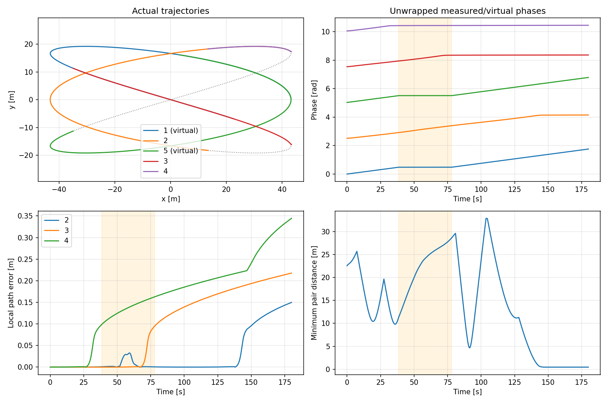
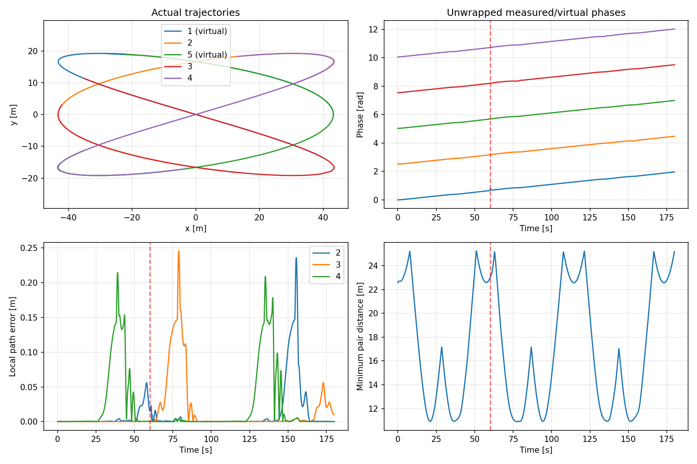
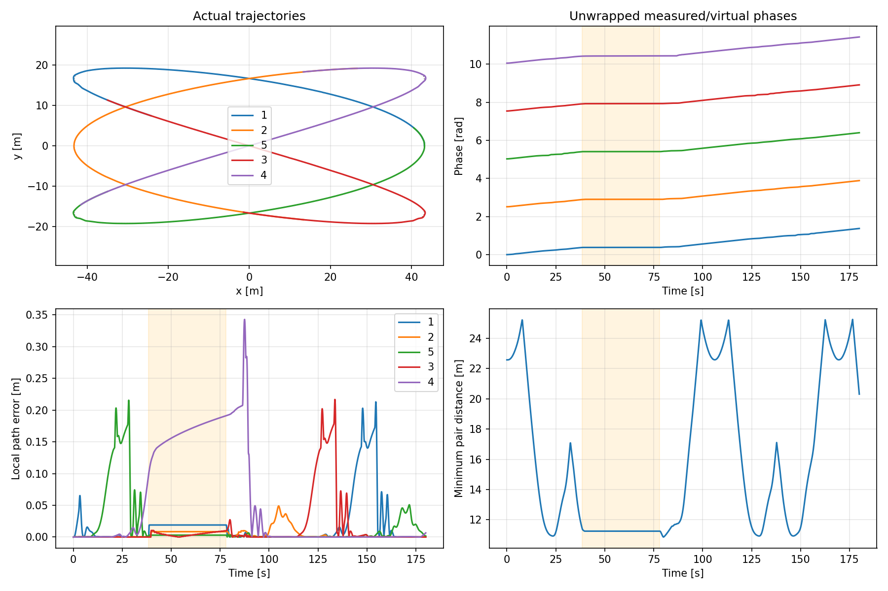

# Kiểm thử các kịch bản trên Gazebo Fortress

Các lượt dưới đây chạy vật lý Gazebo headless, tuần tự để hạn chế ảnh hưởng của tranh chấp CPU. Mỗi kịch bản nhiệm vụ chạy 180 giây mô phỏng, seed 42, 10.000 mục tiêu với sensing đĩa lý tưởng.

| Kịch bản | Kết quả | RMS đường [m] | Max đường [m] | Min khoảng cách [m] | Contact robot | Lỗi cập nhật | Pha cuối RMS [rad] |
|---|---|---:|---:|---:|---:|---:|---:|
| Tuần tra bình thường (3+2) | ĐẠT | 0.0414 | 0.2126 | 10.897 | 0 | 14 | 0.00075 |
| Dừng và phục hồi (3+2) | ĐẠT | 0.0610 | 0.2294 | 10.910 | 0 | 4 | 0.00564 |
| Vòng hở khi dừng tác tử (3+2) | CHƯA ĐẠT | 0.1359 | 0.3444 | 0.460 | 31810 | 0 | 0.56158 |
| Nhiễu pha 0,12 rad (3+2) | ĐẠT | 0.0419 | 0.2458 | 10.900 | 0 | 3 | 0.00053 |
| Năm xe vật lý, dừng và phục hồi | ĐẠT | 0.0540 | 0.3426 | 10.858 | 0 | 4 | 0.00032 |

## Tiêu chí và sự kiện kiểm tra

Đặt tiêu chí trước khi chạy: hoàn tất 180 s, không tiếp xúc giữa robot, khoảng cách mọi cặp trên 0,84 m (đường kính bao xe), RMS bám đường dưới 0,15 m, sai số lớn nhất dưới 0,5 m, dưới 5% cập nhật điều khiển thất bại, phủ lưới toàn đội và phát hiện đủ mục tiêu lý tưởng. Các ca có phản hồi cần sai số pha cuối dưới 0,03 rad. Ca vòng hở cần quan sát được suy giảm đội hình trên 0,05 rad.

Ca dừng/phục hồi kiểm tra tác tử 1 và 5 dừng trong [38,4; 78] s và tiến tiếp sau 120 s. Đội có phản hồi được kiểm tra vận tốc trung bình dưới 0,05 m/s trong đoạn cuối sự cố. Ca nhiễu pha không có sự cố dừng; tác tử ảo 1 nhận bước pha 0,12 rad tại 60 s, được xác nhận bằng bước nhảy pha trong dữ liệu.

- **Tuần tra bình thường (3+2):** các kiểm tra đạt.
- **Dừng và phục hồi (3+2):** các kiểm tra đạt.
  Số đo sự kiện: `{"stopped_agent_1_max_phase_rate": 0.0, "agent_1_phase_progress_after_recovery": 0.6514088816965848, "stopped_agent_5_max_phase_rate": 0.0, "agent_5_phase_progress_after_recovery": 0.6528219836733653, "mean_physical_speed_late_failure": 0.0}`.
- **Vòng hở khi dừng tác tử (3+2):** kiểm tra chưa đạt: no_inter_robot_contact, separation_above_footprint_diameter.
  Số đo sự kiện: `{"stopped_agent_1_max_phase_rate": 0.0, "agent_1_phase_progress_after_recovery": 0.7499999999999989, "stopped_agent_5_max_phase_rate": 0.0, "agent_5_phase_progress_after_recovery": 0.7500000000000062}`.
- **Nhiễu pha 0,12 rad (3+2):** các kiểm tra đạt.
  Số đo sự kiện: `{"observed_phase_jump": 0.10641384666641573}`.
- **Năm xe vật lý, dừng và phục hồi:** các kiểm tra đạt.
  Số đo sự kiện: `{"stopped_agent_1_max_phase_rate": 0.0, "agent_1_phase_progress_after_recovery": 0.5907924014581415, "stopped_agent_5_max_phase_rate": 0.0, "agent_5_phase_progress_after_recovery": 0.5921731268282153, "mean_physical_speed_late_failure": 0.0024220199820803906}`.

Trong cặp đối chứng cùng cấu hình solver được chọn cho báo cáo, sai số pha cuối: phản hồi **0.00564 rad**, vòng hở **0.56158 rad**.

Trong ca vòng hở, hai xe vật lý **2 và 4** có khoảng cách tâm nhỏ nhất **0.460 m** ở khoảng **171.5 s**. Số contact là số mẫu tiếp xúc, không phải số sự kiện va chạm độc lập.

## Hồi quy sau sửa lỗi

Lượt năm xe ban đầu không phục hồi sau sự cố: MPC liên tục hết hạn khi khởi hành lại, khiến cả đội giữ lệnh dừng. Đã sửa giới hạn IPOPT theo wall time, khởi tạo dự đoán chuyển động bằng độ cong đường và tăng tốc khả thi, bỏ warm start cũ sau hold hoặc lỗi giải. Cũng sửa việc đặt lại pha sau gián đoạn odometry; reset thời gian thật vẫn đặt lại trạng thái.

Ma trận phía trên dùng các lượt chạy lại khi được cung cấp. Kết quả cũ được giữ lại, không ghi đè hoặc thay đổi ngưỡng kiểm thử:

- [Năm xe vật lý, dừng và phục hồi trước sửa](gazebo_suite/five_physical_before_fix.json): CHƯA ĐẠT; lượt sau sửa lưu tại `patrol_runs/gazebo_five_restart_fixed`.
- [Dừng và phục hồi (3+2) trước sửa](gazebo_suite/failure_recovery_before_fix.json): ĐẠT; lượt sau sửa lưu tại `patrol_runs/gazebo_hybrid_restart_fixed`.
- [Vòng hở khi dừng tác tử (3+2) trước sửa](gazebo_suite/open_loop_failure_before_fix.json): CHƯA ĐẠT; lượt sau sửa lưu tại `patrol_runs/gazebo_open_loop_failure_restart_fixed`.
- [Nhiễu pha 0,12 rad (3+2) trước sửa](gazebo_suite/phase_perturbation_before_fix.json): ĐẠT; lượt sau sửa lưu tại `patrol_runs/gazebo_phase_perturbation_restart_fixed`.

Các lượt mới giữ nguyên mô hình, chi phí và giới hạn đầu vào MPCC; chỉ thay chính sách khởi tạo và giới hạn thời gian giải. Metadata kèm theo ghi hash mã nguồn từng lượt.

## Pause, reset và watchdog trên Gazebo

- **pause_reset:** ĐẠT. `{"checks": {"pause_freezes_clock_and_vehicle": true, "resume_advances_clock": true, "resume_moves_vehicle": true, "reset_closes_run_as_clock_reset": true}, "measurements": {"paused_sim_advance": 0.0, "paused_displacement": 0.0, "reset_completion_reason": "clock_reset"}, "passed": true}`.
- **watchdog:** ĐẠT. `{"checks": {"stale_state_stops_real_vehicle": true, "watchdog_stop_distance_bounded": true, "phase_continuous_after_data_gap": true, "vehicle_resumes_after_agent_returns": true}, "measurements": {"stale_state_speed": 0.0, "stopping_displacement": 0.3959129545352403, "phase_drop_after_resume": 0.0}, "passed": true}`.

## Biểu đồ và dữ liệu

Vùng tô cam là khoảng dừng tác tử; đường đứt đỏ là thời điểm nhiễu pha. Các trường hợp vòng hở được dùng làm đối chứng, không phải chế độ khuyến nghị vận hành.

### Tuần tra bình thường (3+2)

[Kiểm tra và số đo](gazebo_suite/normal.json) · [Cấu hình](gazebo_suite/normal.yaml)

### Dừng và phục hồi (3+2)

[Kiểm tra và số đo](gazebo_suite/failure_recovery.json) · [Cấu hình](gazebo_suite/failure_recovery.yaml)

### Vòng hở khi dừng tác tử (3+2)

[Kiểm tra và số đo](gazebo_suite/open_loop_failure.json) · [Cấu hình](gazebo_suite/open_loop_failure.yaml)

### Nhiễu pha 0,12 rad (3+2)

[Kiểm tra và số đo](gazebo_suite/phase_perturbation.json) · [Cấu hình](gazebo_suite/phase_perturbation.yaml)

### Năm xe vật lý, dừng và phục hồi

[Kiểm tra và số đo](gazebo_suite/five_physical.json) · [Cấu hình](gazebo_suite/five_physical.yaml)

Log và CSV đầy đủ: [gazebo_scenario_suite](../patrol_runs/gazebo_scenario_suite). Các thư mục `patrol_runs/` được gitignore.

Không suy rộng kết quả sensing lý tưởng thành năng lực cảm biến thực. Bộ điều khiển vẫn không có ràng buộc tránh va chạm hoặc bảo đảm thời gian thực cứng; solver hết hạn gửi lệnh dừng. Kiểm thử headless không xác nhận giao diện GUI/RViz.
