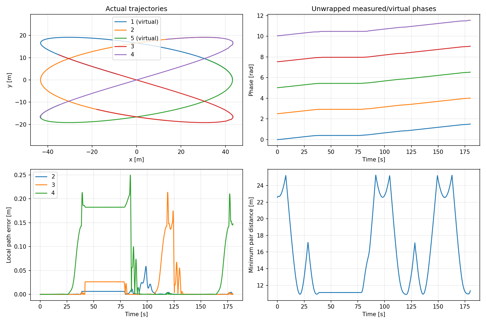
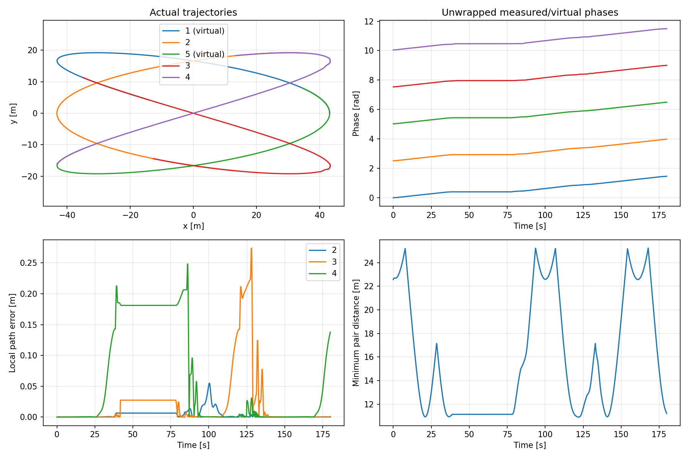
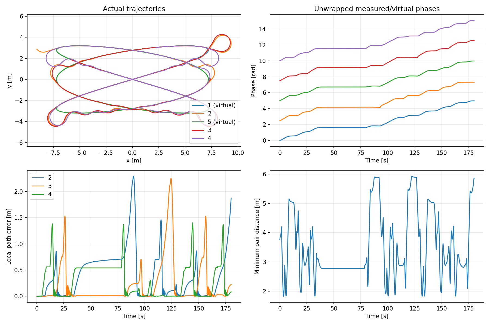

# Báo cáo triển khai và kiểm chứng ROS 2

Ngày kiểm chứng: 2026-11-06. Các kết quả dưới đây được chạy trên máy hiện tại,
không phải dữ liệu thực nghiệm của tác giả bài báo.

**Đợt nghiệm thu 3+2 ban đầu:** cấu hình mặc định chạy đủ 180 s với cảm biến tiếp xúc
đã sửa và kiểm chứng dương. RMS bám đường **0,063 m**, sai số lớn nhất **0,250 m**,
khoảng cách nhỏ nhất **10,897 m**, **0 mẫu tiếp xúc giữa các robot**.
Có **10/5.400** cập nhật chạm giới hạn CPU của solver và chuyển sang lệnh dừng;
thời gian giải p95 **41,2 ms**, lớn nhất **91,6 ms**.
Xem [số đo bản cuối](gazebo_final_180s.json) và hình dưới đây.

Bộ kiểm thử Gazebo mở rộng, các lỗi phát hiện ở lượt năm xe và số đo sau sửa được
ghi riêng trong [báo cáo kịch bản Gazebo](GAZEBO_SCENARIOS.md). Báo cáo đó là kết quả
kiểm chứng mới nhất; các số đo ở đây được giữ làm lịch sử và đối chiếu.

## Những phần đã có

- Tám package ROS 2, build thành công trên Humble/Fortress.
- Xe Ackermann 2WD: URDF/Xacro, quán tính, collision, ros2_control, ground truth,
  wheel odometry, TF và namespace riêng cho từng xe.
- Kuramoto phân tán với vòng truyền thông của bài, tác tử ảo, phép chiếu pha cục bộ
  tránh đổi nhánh tại giao điểm Lissajous.
- MPCC bicycle + mô hình ga, nghịch đảo độ dài cung bằng spline trơn, warm start,
  chẩn đoán bộ giải và dừng khi lỗi/dữ liệu cũ.
- Launch một xe, ba xe + hai tác tử ảo, hoặc năm xe có vật lý.
- Sensing lý tưởng, CSV/JSON/NPZ, rosbag, runner tự đóng thí nghiệm và script xuất biểu đồ.
- CAD tham số và STEP bảy solid, cùng kích thước với URDF.

## Kết quả kiểm tra cơ sở

`bash scripts/check_ros2.sh`: **7/7 đạt**.
Bao gồm cân bằng quay và phục hồi pha, dừng tác tử, ánh xạ độ dài cung nhiều vòng,
phép chiếu tại giao điểm, cấu hình không hợp lệ, phản xạ mục tiêu, đầu vào MPCC
và xe khởi hành lại gần đoạn cua sau khi đứng yên.

`scripts/validate_ros_safety.py`: **3/3 đạt**.
Kiểm tra gửi lệnh 0 khi trạng thái quá hạn, solver lỗi, yêu cầu giữ vị trí và đồng hồ quay lùi;
kiểm tra agent xóa dữ liệu hàng xóm cũ sau reset thời gian và giữ tiến độ pha sau gián đoạn odometry.
Đây là kiểm tra trực tiếp hành vi node; chưa kiểm tra toàn bộ GUI pause/reset bằng thao tác người dùng.

`scripts/validate_vehicle.py`: cả bốn ca đạt ngưỡng của kế hoạch.

| Ca | Vận tốc đo [m/s] | Yaw rate đo [rad/s] | Bán kính đo [m] |
|---|---:|---:|---:|
| Thẳng, yêu cầu 0,4 m/s | 0,4000 | xấp xỉ 0 | — |
| Trái, yêu cầu R=1 m | 0,3931 | 0,3783 | 1,0391 |
| Phải, yêu cầu R=1 m | 0,3974 | -0,3740 | 1,0626 |
| Dừng | 0 | 0 | — |

Chi tiết: [vehicle.json](vehicle.json). Các khớp lái và bánh quay được ghi cùng số đo.

CAD STEP đã được nhập lại bằng CadQuery/OCP và xác nhận có **7 solid** với thể tích dương.
Đây là hình học tham chiếu; chưa kiểm chứng thiết kế chế tạo, dung sai hoặc mối ghép.
Số đo CAD: [cad.json](cad.json). Mã nguồn và STEP được ghi hash trong
[source_manifest.json](source_manifest.json).

## Mô phỏng số

- Mô hình lý tưởng 5 tác tử: chạy 45 s cho cả Kuramoto có phản hồi và vòng hở,
  có khoảng dừng [9,6; 19,5] s. Lưu [phản hồi](ideal_feedback.json) và [vòng hở](ideal_open_loop.json).
- MPCC số theo tham số paper: chạy đủ **30 s**, 900 lần giải, **0 lần giải thất bại**
  sau khi thay bảng nghịch đảo tuyến tính bằng spline trơn. Thời gian p95 khoảng 61,9 ms,
  lớn nhất 104,5 ms; bản số cho phép tới 1 s, không được coi là tất cả lần giải đạt deadline ROS 100 ms.
- MPCC số có sai số đường lớn nhất khoảng **0,337 m**, khoảng cách nhỏ nhất **0,067 m**:
  có nguy cơ va chạm nếu gán bán kính 0,125 m như bài. Không có ràng buộc tránh va chạm.
  Chi tiết: [mpcc_paper_30s.json](mpcc_paper_30s.json).
- Bài phát hiện lý tưởng 15 tác tử, 10.000 mục tiêu: seed **0–9 đều phát hiện đủ mục tiêu**
  và phủ đủ lưới toàn đội trong 10,5 s. Hình học a=7, b=8, A=B=5 là lựa chọn minh họa
  kế thừa bản MATLAB, không khẳng định là bộ dữ liệu gốc của tác giả.
  Chi tiết: [detection_seeds_0_9.json](detection_seeds_0_9.json).

Máy hiện tại không có lệnh MATLAB trên PATH. Vì vậy chưa chạy lại MATLAB để xác nhận
sai lệch Python–MATLAB dưới 10⁻³ rad trên cùng dữ liệu; các phép kiểm tra phương trình
và tích phân Python đã đạt. Đã thêm `matlab/export_ros_reference.m` và
`scripts/compare_matlab.py` để thực hiện đối chiếu khi có MATLAB.
Không sửa các hàm MATLAB gốc hoặc các thay đổi di chuyển thư mục có sẵn của người dùng.

## Gazebo: so sánh đường phóng đại và đường khả thi

Cả hai thí nghiệm 180 s dưới đây chạy 3 xe vật lý + 2 tác tử ảo, dừng tác tử 1 và 5
ở [38,4; 78] s rồi phục hồi. MPCC dùng ngưỡng 100 ms.

| Chỉ số | Đường x4, `scaled` | Đường x24, `feasible` |
|---|---:|---:|
| Thời lượng mô phỏng | 180 s | 180 s |
| Số mẫu đánh giá | 1.801 | 1.801 |
| Sai số bám đường RMS | 0,511 m | 0,066 m |
| Sai số bám đường lớn nhất | 2,292 m | 0,274 m |
| Khoảng cách nhỏ nhất, mọi cặp | 1,826 m | 10,897 m |
| Cập nhật điều khiển thất bại | 657 / 5.400 | 37 / 5.400 |
| Thời gian giải p95 | 64,2 ms | 46,7 ms |
| Phủ lưới toàn đội, sensing lý tưởng | 100% | 100% |
| Mục tiêu phát hiện | 10.000 / 10.000 | 10.000 / 10.000 |

Các cập nhật thất bại chuyển sang lệnh dừng và có ghi trong `control.csv`.
Thời gian trong bảng là wall time, còn IPOPT cũng có giới hạn CPU time; có thể chạm
giới hạn CPU trước khi wall time đạt 100 ms. Không tuyên bố điều khiển thời gian thực cứng.

Do vùng x24 lớn, trong 180 s không phải mọi tác tử đều hoàn thành phủ lưới riêng:
độ phủ từng tác tử khoảng **95,3–100%**. Độ phủ toàn đội không đồng nghĩa độ phủ từng tác tử.
Bán kính cảm biến đĩa lý tưởng được tính theo kích thước vùng, nên cũng tăng khi phóng đại vùng.

Đường x4 cần góc lái khoảng 62°, vượt giới hạn 20°; đường x24 cần khoảng 17,4°.
Vì vậy triển khai **đổi mặc định chạy sang `feasible.yaml`**, giữ `scaled.yaml` để đối chiếu.
Đây là điều chỉnh dựa trên kiểm chứng so với kế hoạch gốc, không đổi nội dung kế hoạch đã lưu.

Lưu số đo tổng hợp tại [gazebo_feasible_180s.json](gazebo_feasible_180s.json) và
[gazebo_scaled_180s.json](gazebo_scaled_180s.json).
Rosbag và dữ liệu đầy đủ nằm trong `patrol_runs/`, được gitignore để tránh đưa dữ liệu lớn vào repo.

Ngoài ra đã chạy thử **năm xe vật lý trong 12 s**, có dừng/phục hồi: RMS 0,014 m,
sai số lớn nhất 0,067 m, 0 lỗi cập nhật điều khiển. Đây là kiểm tra mở rộng ngắn,
chưa phải thí nghiệm dài năm xe. Xem [gazebo_five_smoke.json](gazebo_five_smoke.json).

## Kiểm chứng cảm biến tiếp xúc

Qua kiểm tra rosbag, phát hiện Fortress 6 yêu cầu topic riêng trong `<contact><topic>`;
topic ở cấp `<sensor>` chưa được Contact system sử dụng. Đã sửa theo mã nguồn
[Contact system của Fortress](https://github.com/gazebosim/gz-sim/blob/ign-gazebo6/src/systems/contact/Contact.cc).

Các lượt 180 s kể trên được ghi **trước bản sửa topic này**: các trường contact=0 của chúng
không phải bằng chứng cảm biến không phát hiện va chạm. Khoảng cách tâm nhỏ nhất đều lớn
hơn tổng bán kính bao thân xe, nên dữ liệu vị trí vẫn cho thấy không chồng lấn trong các mẫu đã đo.

Sau bản sửa:

- Chạy lại 3+2 trong 12 s, rosbag ghi hơn **64.000 message contact mỗi xe**;
  lọc bỏ tiếp xúc với nền và trong cùng xe, kết quả 0 mẫu tiếp xúc giữa các robot.
  Xem [gazebo_contact_smoke.json](gazebo_contact_smoke.json).
- Tạo vật thể `robot_99` cố ý giao với xe trong world kiểm tra riêng; cảm biến ghi nhận
  tiếp xúc thật giữa bánh trước trái robot 2 và vật thể. Kiểm tra dương **đạt**:
  [contacts.json](contacts.json). Kiểm tra này xác nhận cả luồng Gazebo → bridge → ROS.

Cuối cùng đã chạy lại **đủ 180 s sau bản sửa topic contact** với cấu hình mặc định;
kết quả ở đầu báo cáo và [gazebo_final_180s.json](gazebo_final_180s.json).
Lượt cuối lưu CSV/JSON/NPZ, không ghi lặp rosbag; các lượt trước và lượt contact smoke đã có rosbag.
Độ phủ từng tác tử ở lượt cuối khoảng **95,7–100%**, độ phủ toàn đội 100%.
Dữ liệu contact nhiều làm tăng tải CPU/rosbag; cần đánh giá lại deadline trên máy khác
và khi tăng đội xe.

## Các giới hạn còn lại

- Mô phỏng vật lý chưa tái tạo chính xác truyền động ga/mô-men của xe thật; adapter vận tốc
  dùng mô hình ga tương đương, và ga tối thiểu 0 khác paper.
- Không có ràng buộc tránh va chạm trong MPCC; cảm biến tiếp xúc và khoảng cách chỉ đo kết quả.
- Chưa mô phỏng vật cản, mất liên lạc kéo dài, định vị nhiễu hoặc cảm biến nhận dạng thực.
- CAD chưa có cơ cấu truyền động/lái, chi tiết lắp ráp hoặc dung sai sản xuất.
- Chưa kiểm tra GUI Gazebo/RViz bằng quan sát trực tiếp; các lượt kiểm chứng Gazebo chạy headless.
