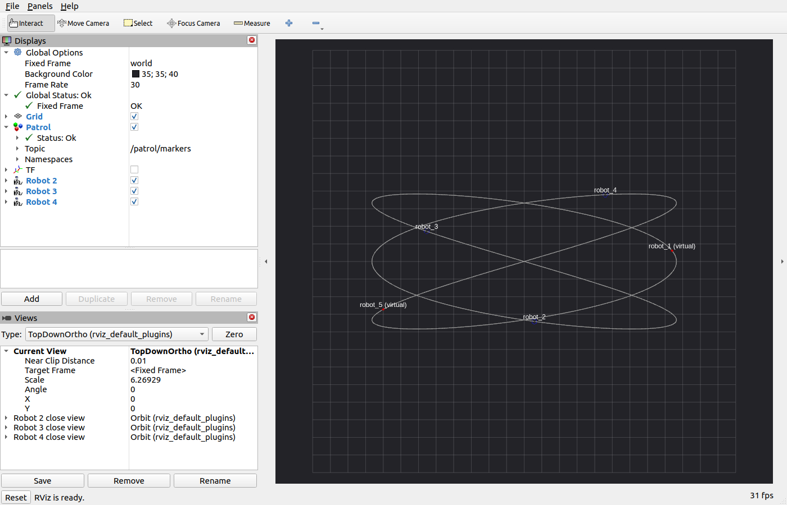
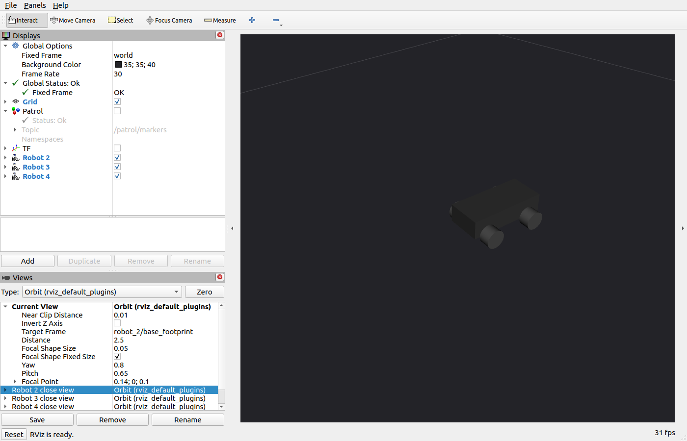

# Kiểm thử RViz — 2026-11-06

Đã chạy Gazebo Fortress server thật và RViz2 trên DISPLAY=:1, ROS domain riêng.
Các lượt trước trong GAZEBO_SCENARIOS.md chỉ kiểm thử headless.

Các lỗi đã sửa:
- Panel Displays thiếu Name; các display thiếu Value; MarkerArray dùng sai khóa topic.
- Chưa cấu hình RobotModel, công cụ camera và góc nhìn bao quát scenario.
- Controller Humble phát TF trên `~/tf_odometry`, cần remap sang `/tf` để nối
  `world -> robot_i/odom -> robot_i/base_footprint -> thân/bánh`.
- Node đánh giá từ chối thư mục mặc định đã có kết quả. Mặc định nay tạo tên duy nhất;
  vẫn bảo vệ dữ liệu khi người dùng chỉ định thư mục đã có kết quả.
- Marker chỉ xuất sau start barrier, dừng khi hết nhiệm vụ và chưa lưu mẫu cho subscriber muộn.
  Nay xuất từ lúc chờ đến sau khi kết thúc, QoS transient local.

Kết quả:
- Hai lần khởi chạy liên tiếp tạo hai thư mục khác nhau, không lỗi trùng kết quả.
- Giao diện có Displays, Views, thanh công cụ; Patrol Status: Ok, ba RobotModel hết lỗi.
- Nhiệm vụ ngắn 8 giây hoàn tất với `duration_reached`.
- Subscriber tạo sau khi kết thúc vẫn nhận 11 marker: đường, 5 tác tử, 5 nhãn.
- 12 phép tra TF world tới thân/bánh của cả ba xe đều thành công.
  Xem [topic_tf_check.json](rviz/topic_tf_check.json).
- `bash scripts/check_ros2.sh`: 7/7 kiểm thử đạt.

Ảnh RViz sau khi nhiệm vụ hoàn tất:

Góc nhìn cận cảnh theo từng xe có trong Views. Ảnh tổng quan dùng tỷ lệ thật;
xe 0,46 m nhỏ hơn nhiều so với đường rộng 86,4 m.

Đã mở góc nhìn theo robot 2 và tắt Patrol để quan sát riêng URDF:

